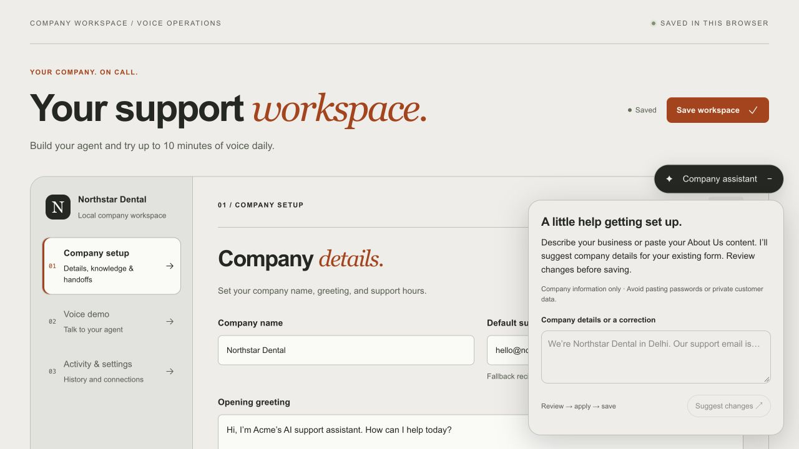

# Company assistant verification — 24 October 2026

Implemented locally; no deployment, credential rotation, Google Console change, or existing company-record migration was performed.

## Results

- Existing local test suite: **139 passed, 22 skipped, zero failures** (161 cases). Includes **15 new assistant regression tests** covering strict field boundaries, authentication/tenant authorization, manipulated direct requests, origin checks, unrelated questions, prompt/secret/SQL/XSS attempts, malformed output, oversized input, upload cancellation, provider failures, safe updates, stale forms, unfinished drafts, token-efficient context, credential rejection, and IndexedDB persistence.
- Existing hardening checks: **15 passed, one skipped, zero failures**. The skipped cases are existing optional integration/legacy checks; they are not counted as passes.
- ESLint: passed. Next.js production compilation and its validity checks: passed. The existing notice about the Next.js ESLint plugin remains informational.
- Secret scan: passed for staged/tracked/current files and generated browser assets, including the configured Gemini key; values were not printed. Env files remain untracked and excluded from container contexts. The endpoint's responses do not include the key or raw provider errors.
- Real PostgreSQL checks: passed in an isolated temporary schema, removed afterward. Six concurrent reservations allowed one active request; later requests returned 429. Three completed requests blocked a fourth within a rolling minute, including the 59-second boundary, while admission resumed after 61 seconds. Duplicate IDs/payloads, shared-network limits, per-user/site daily counts, token/spending limits, conservative failure accounting, active failure leases, and lease-expiry recovery passed. A reviewed proposal persisted using the existing encrypted workspace API; decrypted reads matched the saved profile and raw storage contained ciphertext. Rejected protected-field output left the stored payload unchanged.
- Real Gemini calls: **seven scenarios passed** with **gemini-3.5-flash-lite**, **3,122 total tokens** across that successful run. Synthetic data only. Scenarios: About Us extraction, Saturday closing-time correction preserving Monday, bare email follow-up, technical/mathematical business description, unrelated ambiguous request, contradictory contacts, and indirect instruction override in pasted company content. Individual successful scenarios used 328–773 total tokens. Explicit test scripts bypass application billing reservations and are for local integration verification only.
- Compiled production endpoint smoke tests: direct unauthenticated POST → **401**, hostile Origin → **403**, both with private/no-store responses and no key disclosure.
- In-app browser: actual production `SupportStudio`/`CompanyAssistant` components in the disposable localhost fixture. Verified open, synthetic description → proposal, existing values unchecked by default, explicit replacement selection, Apply updating the actual form, minimize, existing Save workspace action, persistence after reload, reopen, and continued availability under Activity & settings. The fixture uses synthetic authentication/provider responses; the real Gemini and PostgreSQL paths were tested separately. No live end-to-end Google OAuth session or deployed production/browser test is claimed. Desktop layout visually checked at 1280×720. Responsive width/height rules are implemented; a separate mobile-device session was not run.

## Issues found and fixed

1. Zod defaults were initially inserting unrelated patch values. Assistant patch validators now remove defaults and reject unknown fields while preserving ordinary form defaults.
2. Gemini rejected parts of the raw generated JSON Schema. Provider schema now retains only its supported structure; full validation still runs outside Gemini.
3. Numeric weekdays were unreliable in a real Saturday update. Provider output now uses weekday names, translated and checked independently against the existing Monday=0 convention.
4. An ambiguous PostgreSQL arithmetic parameter in token reconciliation was found by actual database testing and corrected with explicit integer casts.
5. Incomplete manually edited form values can now coexist with valid proposed corrections without being overwritten or blocking unrelated updates.

## Production handoff

See [configuration and security notes](../../COMPANY_ASSISTANT.md). Provision the shared DB metadata table/index permissions, runtime key/secrets and existing Google account auth, Google key restrictions, billing/quota settings, and price configuration. Netlify uses its existing platform-set network header. Other production hosts, including Docker, need a trusted network adapter; arbitrary forwarded-IP headers are intentionally unsupported. The assistant fails closed if durable usage protection or trustworthy network identity is unavailable. Application dollar controls are estimates for this feature, not a guarantee on the provider's full project bill.
