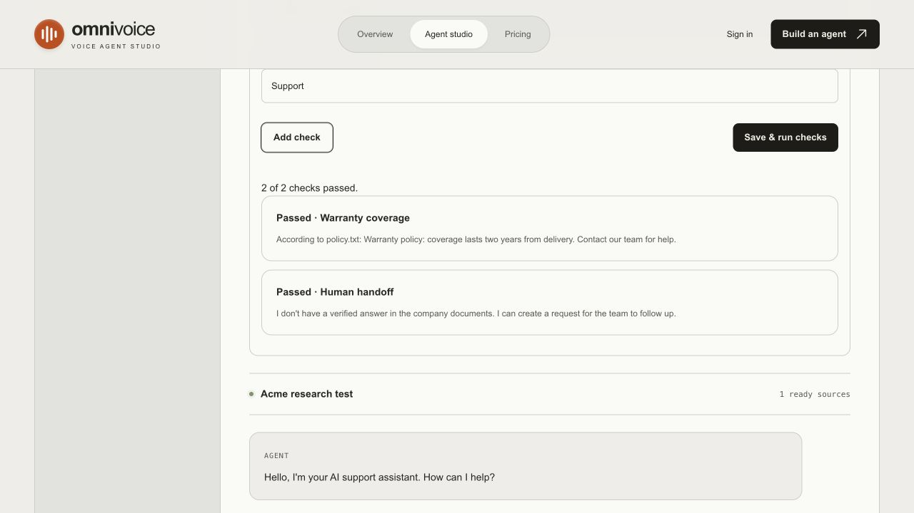

# Open-source voice-agent research · 16 October 2026

**Recommendation:** keep ElevenLabs Agents as the live conversation engine. Adopt evaluation and release-management patterns from Pipecat, LiveKit and Dograh around it. These projects are ahead of our app in important areas, but none of the inspected code establishes that replacing ElevenLabs would improve our real call quality, latency or total operating cost. We have not benchmarked their runtimes.

## Ranked shortlist

Ranked by GitHub stars **among the four projects selected for focused source inspection**, not as a claim these are the four most-starred repositories mentioning voice. Exact counts came from GitHub's repository API during this research. Stars/forks are adoption signals, not security or quality certifications.

| Rank | Repository | Stars | Forks | License inspected | Best use for OmniVoice |
|---|---|---:|---:|---|---|
| 1 | [Pipecat](https://github.com/pipecat-ai/pipecat) | 16,531 | 2,892 | BSD-2-Clause | Scenario evaluations, explicit result states, reconnect/error handling, metric boundaries |
| 2 | [LiveKit Agents](https://github.com/livekit/agents) | 14,769 | 3,945 | Apache-2.0, with NOTICE | Grounded-answer/tool-routing tests, handoffs, mature realtime runtime and observability |
| 3 | [TEN Framework](https://github.com/TEN-framework/ten-framework) | 11,171 | 1,366 | Mixed: restricted root/core license; `ai_agents/` Apache-2.0 | Interruption/reconnection and audio-timing test coverage; study component boundaries |
| 4 | [Dograh](https://github.com/dograh-hq/dograh) | 5,888 | 1,499 | BSD-2-Clause | Closest full-product reference: organizations, draft/published versions, durable webhooks and workflows |

The machine-readable [repository snapshot](research/github-repositories.json) includes API observation time, activity, archive status, descriptions and other screened candidates. [The source manifest](research/source-manifest.json) records exact upstream revisions, file paths, permanent links and SHA-256 hashes. Thirty-four files were downloaded for targeted inspection: licenses/READMEs and the relevant evaluation, metrics, retry, workflow/versioning and webhook code. This is a focused source review, not a full audit of all four codebases. Upstream programs, install scripts, repository agent instructions and dependencies were not executed.

Other candidates screened, ranked separately by stars:

| Repository | Stars | Forks | Reason it was not one of the four focused targets |
|---|---:|---:|---|
| [Hugging Face speech-to-speech](https://github.com/huggingface/speech-to-speech) | 13,480 | 1,721 | Relevant self-hosted model pipeline; would replace hosted conversation infrastructure rather than improve our company control plane directly |
| [Stream Vision Agents](https://github.com/GetStream/Vision-Agents) | 8,171 | 694 | Relevant runtime with a stronger vision/video focus; Dograh is closer to our company support workflow |
| [Vocode Core](https://github.com/vocodedev/vocode-core) | 3,804 | 656 | Modular voice framework, but GitHub reported its latest push in November 2024; less current than the selected alternatives |
| [ElevenLabs UI](https://github.com/elevenlabs/ui) | 2,424 | 176 | Useful MIT UI reference; our existing SDK/custom theme does not need a second component stack for this change |
| [Bolna](https://github.com/bolna-ai/bolna) | 794 | 374 | Relevant MIT voice orchestration, lower adoption; the repository README says its hosted no-code UI is closed source |
| [ElevenLabs examples](https://github.com/elevenlabs/examples) | 629 | 285 | Useful first-party integration examples, rather than a complete multi-company support product |
| [Jambonz feature server](https://github.com/jambonz/jambonz-feature-server) | 104 | 78 | Lower-level telephony infrastructure; unnecessary while ElevenLabs owns media/telephony |
| [ElevenLabs CLI](https://github.com/elevenlabs/cli) | 100 | 19 | Useful first-party agent configuration tooling; does not replace our application/tenant controls |

## What the inspected code showed

**Pipecat** has reusable scripted/persona evaluation scenarios and results that distinguish failed, passed and not-run work. Its WebSocket base coordinates reconnect attempts, uses bounded backoff, and stops retrying terminal failures. It is much broader than our app's speech runtime because it owns media and provider pipelines. We adopted explicit local-check result states and bounded randomized retry behavior as independently written code. Sources: [scenario model](https://github.com/pipecat-ai/pipecat/blob/9c333afa40c06decf7a5973ad34ab1a111c9401a/src/pipecat/evals/scenario.py), [result states](https://github.com/pipecat-ai/pipecat/blob/9c333afa40c06decf7a5973ad34ab1a111c9401a/src/pipecat/evals/results.py), [WebSocket recovery](https://github.com/pipecat-ai/pipecat/blob/9c333afa40c06decf7a5973ad34ab1a111c9401a/src/pipecat/services/websocket_service.py).

**LiveKit Agents** has knowledge-grounding tests covering routing, known facts and absent/contradictory facts, plus agent behavior/tool assertions. Those example evaluations exercise actual LLMs and a judge; we did not present our deterministic document-search checks as equivalent. Its metrics distinguish model work, cancellation and time-to-first-token; adopting its local audio-stage metrics would be misleading when ElevenLabs owns those stages. Sources: [grounding evaluations](https://github.com/livekit/agents/blob/8f6ab57395d12e416d9c8f5c816efbbf410e16a4/examples/homepage/tests/evals/test_knowledge_grounding.py), [metric schema](https://github.com/livekit/agents/blob/8f6ab57395d12e416d9c8f5c816efbbf410e16a4/livekit-agents/livekit/agents/metrics/base.py).

**TEN Framework** has extensive interruption, reconnect and timing integration tests around actual ASR/TTS extensions. These are valuable scenarios for a later credentialed voice test: interrupt mid-answer, disconnect/reconnect, duplicate start, long sessions and partial speech. They cannot be honestly validated through our local text search. The [root license](https://github.com/TEN-framework/ten-framework/blob/ff0f29b56e9d8a6b0f8d8b6af9a475ec4ab47ba3/LICENSE) contains extra deployment/competition restrictions; the [agent subtree license](https://github.com/TEN-framework/ten-framework/blob/ff0f29b56e9d8a6b0f8d8b6af9a475ec4ab47ba3/ai_agents/LICENSE) is Apache-2.0. No TEN implementation was copied. Sources: [reconnection tests](https://github.com/TEN-framework/ten-framework/blob/ff0f29b56e9d8a6b0f8d8b6af9a475ec4ab47ba3/ai_agents/agents/integration_tests/asr_guarder/tests/test_reconnection.py), [interruption tests](https://github.com/TEN-framework/ten-framework/blob/ff0f29b56e9d8a6b0f8d8b6af9a475ec4ab47ba3/ai_agents/agents/integration_tests/tts_guarder/tests/test_append_interrupt.py).

**Dograh** is closest to our product's intended scope. Its workflow client separates draft/published/archived versions and a released-definition pointer; its webhook worker persists delivery state, retries selected failures and redacts request metadata. We adopted revision receipts and saved-change detection. We did not import its campaign retry mechanism into outbound call creation, where retrying a request can place duplicate calls. Sources: [workflow lifecycle](https://github.com/dograh-hq/dograh/blob/417c9a74156f518de814cc55b579eb96a9656d5a/api/db/workflow_client.py), [durable webhook delivery](https://github.com/dograh-hq/dograh/blob/417c9a74156f518de814cc55b579eb96a9656d5a/api/tasks/webhook_delivery.py).

## Implemented in OmniVoice

1. **Company knowledge regression checks.** Connected companies can save up to 25 named questions with expected answer phrases, source filename, human handoff and destination team. The Test conversation panel saves/runs them; reports show pass/fail/not-run and become stale after relevant saved edits. Cases and reports use the existing encrypted JSON storage. Passage tokenization is reused across a suite, and evaluation concurrency is bounded to one per API process with a six-per-minute run quota. Tenant authorization applies to every route.
2. **Publishing gate.** Configured checks rerun at publish submission and worker execution; failures block the publish before a provider call. Checks edited while sources are indexing invalidate that publication. An empty suite is explicitly `not_run`, not a passing test; the suite is optional and a company administrator can change/remove its policy. Checks exercise local document search and routing, **not ElevenLabs RAG, live LLM behavior, audio or tool adherence**.
3. **Publication receipts.** The worker retains the last ten successful receipts per company, with source revision, time, document count and local-check counts. Current saved profile/documents/checks, generated prompt, agent mapping and embedding model determine the revision. Saved changes after publication mark it outdated. Receipts are metadata, not full source snapshots: rollback, provider-side drift detection and cross-system atomic transactions are not implemented.
4. **Safer provider resilience.** Safe GET/PATCH/DELETE requests retry selected transient status/network failures with bounded randomized backoff. Numeric and HTTP-date Retry-After values are respected. Non-idempotent POSTs, including calls and document creation, are never automatically repeated. Server waits above 30 seconds surface as a failure for later retry, rather than being shortened.

All application additions were independently implemented from the reviewed design patterns. No foreign runtime code or framework dependency was vendored. If a future change copies implementation text, retain the relevant copyright/license/NOTICE and check the exact subdirectory license first.

## Architecture decision and next steps

Keep: our tenant API, upload review/security, SMTP escalation storage, company studio, and direct ElevenLabs signed sessions/native knowledge indexing. Swapping Pipecat/LiveKit/TEN into the live path would move responsibility for transport, endpointing, interruptions, STT/LLM/TTS integration, observability, scaling and failure recovery onto our infrastructure. That could be appropriate for a future self-hosting/control requirement, but is a larger product decision; stars alone do not justify it.

Useful later work: real ElevenLabs agent evaluations using the same company questions; recorded interruption/noise/language scenarios; first-party agent configuration versioning; provider-reported latency/cost metrics with honest provenance; durable outbound company webhooks; tenant membership and full self-service onboarding. Those require separate implementation and, for live testing, your provider configuration. No credentials were added, upstream code executed, real calls placed or email sent by this research.

## Validation of this adaptation

The full backend suite passed **152 tests**; frontend unit tests passed **31 tests**. Lint and the optimized production build passed. The existing optional Next lint-plugin warning remains. No runtime dependencies were added. Source scanning found no high-severity issues; the existing sandbox `/tmp` warnings and low-severity findings are reviewed in the [security report](security.md). Retry jitter uses non-cryptographic randomness for timing only.

The in-app browser exercised a disposable company against the real backend: a matching warranty phrase passed, an incorrect phrase failed, and a human handoff passed. The company API enforced the checks and persisted results. The temporary UI harness used dummy data and a private local proxy, so it did not require real administrator/database credentials or modify production authentication. Backend tests separately covered tenant denial, configured-check publishing failures, stale revisions, release retention/isolation, safe retries and cancellation resource bounds. Live ElevenLabs sessions/agent quality and production PostgreSQL concurrency remain untested here. Temporary app/test servers were stopped.

## TEN reuse authorization and follow-up

On 16 October 2026, the project owner stated that they have permission to reuse TEN, including root-licensed material, and will supply the relevant owner licensing. This records the owner's instruction; it does not replace or alter upstream license notices. Preserve the original licenses, attribution, exact source revision and any supplied additional grant when importing implementation code.

A follow-up review compared TEN's reconnect/interruption scenarios with the installed ElevenLabs React SDK. The SDK already guards concurrent media connections and cleans up active/pending SDK sessions. The app's earlier HTTP signed-session preflight had a separate gap: it could finish after the studio unmounted. The app now aborts that request on unmount/cancel, suppresses stale completions, prevents duplicate preflight requests, and bounds signed-URL fetching to 15 seconds. A cancelled attempt cannot invalidate its replacement. This is an independently written adaptation of the lifecycle scenarios, not a claim that TEN's ASR/TTS runtime is running in the app.
